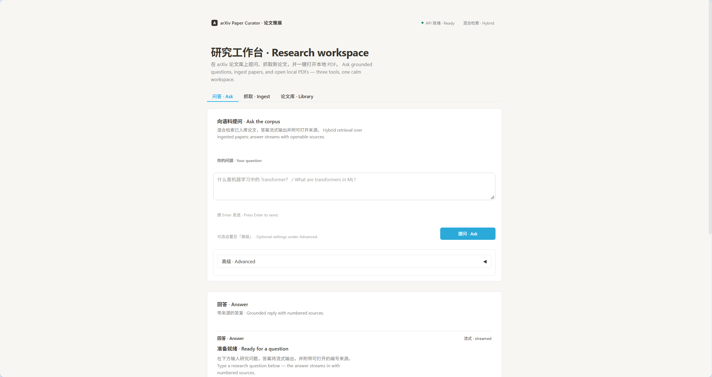
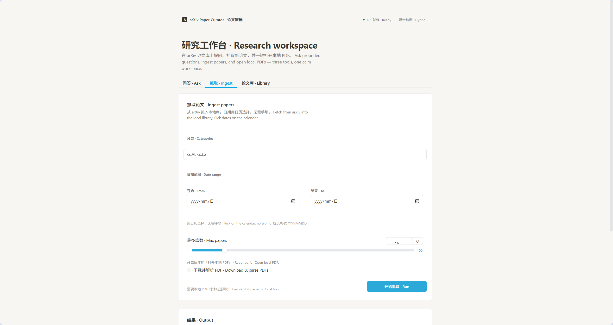
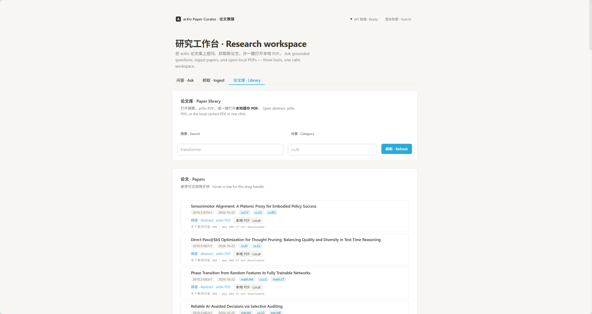

# arXiv Paper Curator

Production-style RAG system that fetches arXiv papers, parses PDFs, indexes into OpenSearch, and answers research questions with hybrid retrieval + LLM (DeepSeek API).

## Screenshots / 界面预览

Gradio 研究工作台(Research workspace)——问答、抓取、论文库三个页签:

**问答 · Ask** — 混合检索已入库论文,答案流式输出并附可打开的来源:



**抓取 · Ingest** — 从 arXiv 抓取论文入库,支持分类、日期范围与下载数量:



**论文库 · Library** — 浏览、检索论文,一键打开摘要 / arXiv PDF / 本地缓存 PDF:



## What this project does

1. **Ingest** — fetch papers from arXiv (abstract + optional PDF), store metadata in PostgreSQL
2. **Parse & chunk** — Docling PDF parsing, section-aware chunking
3. **Index** — hybrid index in OpenSearch (BM25 + vectors)
4. **Embed** — Jina embeddings (API) or local **BGE** fallback (`BAAI/bge-large-zh-v1.5`)
5. **Answer** — simple RAG and agentic RAG (LangGraph: guardrail → retrieve → grade → generate / rewrite)
6. **UI** — Gradio app for Q&A, paper ingest, and library browsing
7. **Feishu bot** — optional webhook at `/feishu/`

## Stack

| Component | Role |
|-----------|------|
| FastAPI | API (`:8000`) |
| Gradio | Local UI (`:7861`) |
| PostgreSQL | Paper metadata |
| OpenSearch | Hybrid search (BM25 + vector, RRF) |
| Redis | Answer cache |
| Docling | PDF → text |
| Jina / BGE | Embeddings (API / local) |
| DeepSeek API | LLM generation |
| LangGraph | Agentic RAG workflow |

## Quick start

```bash
# 1. Copy env and fill in keys (Jina optional if using BGE; DeepSeek required for answers)
cp .env.example .env

# 2. Start infrastructure + API
docker-compose up --build -d
# or: make start

# 3. Install Python deps (Gradio / scripts run on host)
uv sync

# 4. Open UI
uv run python gradio_launcher.py
# http://127.0.0.1:7861
```

**Ingest:** use Gradio「抓取论文」, or:

```bash
uv run python scripts/ingest.py --categories cs.AI --max 5
```

## API (main)

| Method | Path | Description |
|--------|------|-------------|
| GET | `/api/v1/health` | Service health |
| POST | `/api/v1/ask` | Simple RAG |
| POST | `/api/v1/ask-agentic` | Agentic RAG (LangGraph) |
| POST | `/api/v1/stream` | Streaming answers |
| POST | `/api/v1/hybrid-search/` | Hybrid retrieval |
| POST | `/api/v1/ingest` | Fetch + index papers |
| GET | `/api/v1/papers` | Paper library |
| GET | `/api/v1/papers/{id}/pdf` | PDF file |

## Embeddings: Jina vs BGE

- **Default:** Jina API (`JINA_API_KEY`) — 1024-dim, matches hybrid index
- **Local fallback:** BGE (`BGE_MODEL_NAME`, no API key) — useful when cloning without Jina

Vector dimension is configured in `.env` (`OPENSEARCH__VECTOR_DIMENSION=1024`).

## Feishu (optional)

Set `FEISHU__*` in `.env`, enable the bot in [Feishu Open Platform](https://open.feishu.cn/app), subscribe to `im.message.receive_v1`, webhook URL `http://<host>:8000/feishu/`. See [docs/FEISHU.md](docs/FEISHU.md).

## Project layout

```
src/
  main.py              # FastAPI lifespan + service wiring
  routers/             # ask, agentic_ask, hybrid_search, library, ping
  services/
    arxiv/             # arXiv client
    pdf_parser/        # Docling
    indexing/          # chunk + hybrid indexer
    embeddings/        # Jina + BGE
    opensearch/        # query builder + client
    llm/               # DeepSeek client + RAG prompts
    agents/            # LangGraph agentic RAG
    cache/             # Redis
    feishu/            # Feishu bot
    rerank/            # Jina reranker (optional)
scripts/               # ingest, PDF tests
docs/                  # RUNBOOK, FEISHU, screenshots (项目截图)
compose.yml            # api, postgres, opensearch, redis
```

## Development

```bash
make format     # ruff format
make lint       # ruff + mypy
make test       # pytest
make health     # API + OpenSearch
```

## Notes

- PDF parsing uses Docling models cached under `~/.cache/huggingface` (mounted into the API container).
- Primary LLM is **DeepSeek API** (`DEEPSEEK_*`); there is no local LLM runtime in this repo.
- Ingest is script/UI driven.
