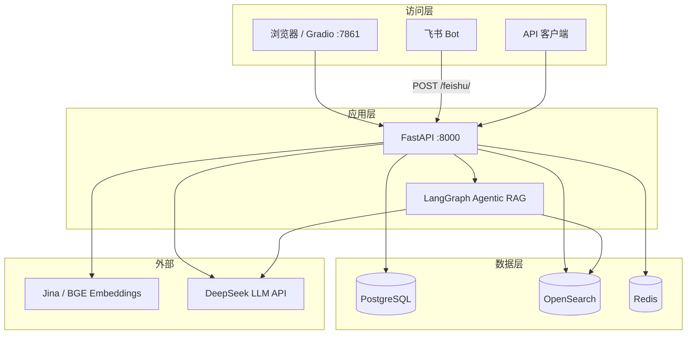

# arXiv Paper Curator — 系统架构

## 服务总览

| 服务 | 端口 | 作用 | 依赖 |
|------|------|------|------|
| api | 8000 | FastAPI 主服务 + 飞书 Webhook | postgres, opensearch, redis |
| redis | 6379 | 查询/答案缓存 | - |
| opensearch | 9200 | 混合检索（BM25 + 向量） | - |
| opensearch-dashboards | 5601 | 检索可视化（可选） | opensearch |
| postgres | 5432 | 论文元数据 | - |
| Gradio（宿主机） | 7861 | 本地 UI | api |

外部依赖：**DeepSeek API**（生成）、**Jina** 或本地 **BGE**（向量）。



## 数据流

### 问答（Simple RAG）

用户提问 → Redis 查缓存 →（未命中）Embedding → OpenSearch 混合检索 → 构建 Prompt → DeepSeek 生成 → 写缓存 → 返回答案 + 来源

### 问答（Agentic RAG / LangGraph）

```
guardrail → retrieve → grade_documents
                         ├→ generate_answer → END
                         └→ rewrite_query → retrieve（最多重试）
guardrail 不通过 → out_of_scope → END
```

### 入库

Gradio / `scripts/ingest.py` / `POST /api/v1/ingest`  
→ arXiv API 拉元数据（可选 PDF）→ PostgreSQL → Docling 解析 → 分块 → Embedding → OpenSearch 混合索引

## 关键配置

| 配置项 | 默认 | 说明 |
|--------|------|------|
| LLM | deepseek-flash | `DEEPSEEK_*` |
| 向量 | Jina 或 BGE-large-zh | 1024 维 |
| 分块 | 600 / 重叠 100 | `CHUNKING__*` |
| Top-K | 3 | 检索文档数 |
| 缓存 TTL | 6 小时 | Redis |
| Guardrail | 0–100，阈值 60 | Agentic |

## Docker 网络

单桥接网络 `rag-network`；容器内用服务名互访（如 `postgres:5432`、`opensearch:9200`）。

## 健康检查

| 服务 | 命令 | 间隔 |
|------|------|------|
| api | `/api/v1/health` | 30s |
| redis | `redis-cli ping` | 10s |
| opensearch | `_cluster/health` | 30s |
| postgres | `pg_isready` | 5s |
