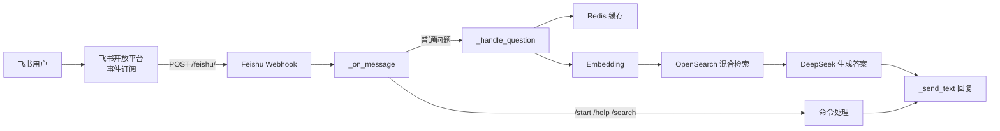

# 飞书机器人接入指南

把 arXiv Paper Curator 的 RAG 问答能力接到飞书。代码位置：

- `src/services/feishu/bot.py` — 事件处理、RAG 问答、消息回复
- `src/services/feishu/factory.py` — 按配置创建 / 禁用 bot
- `src/main.py` lifespan — 启动 bot 并把 Webhook 挂到 `/feishu`



---

## 1. 开放平台配置

1. 登录 [飞书开放平台](https://open.feishu.cn/app)，创建**企业自建应用**
2. **应用能力** → 添加**机器人**
3. **凭证与基础信息**：复制 `App ID`、`App Secret`
4. **事件与回调**：
   - **加密策略**：复制 `Verification Token`、`Encrypt Key`
   - **事件订阅**：请求地址填  
     `https://<公网可达域名>/feishu/`  
     （本地开发用 ngrok / cpolar / frp 做 HTTPS 隧道，路径必须以 `/feishu/` 结尾）
   - 添加事件：**接收消息 `im.message.receive_v1`**
5. **权限管理** 开通：

   | 权限 | 用途 |
   |------|------|
   | `im:message` | 读取用户发来的消息 |
   | `im:message:send_as_bot` | 机器人发消息 |
   | `im:chat`（可选） | 群聊信息 |

6. **版本管理与发布** → 创建版本 → 发布

## 2. 环境变量

在项目根目录 `.env` 中配置（模板见 `.env.example`）：

```ini
FEISHU__ENABLED=true
FEISHU__APP_ID=cli_xxxxxxxxxxxxxxxx
FEISHU__APP_SECRET=xxxxxxxxxxxxxxxxxxxxxxxx
FEISHU__VERIFICATION_TOKEN=xxxxxxxxxxxxxxxxxxxxxxxx
FEISHU__ENCRYPT_KEY=xxxxxxxxxxxxxxxxxxxxxxxx
```

| 环境变量 | 必填 | 说明 |
|----------|------|------|
| `FEISHU__ENABLED` | 是 | 默认 `false`；为 `false` 时 bot 不初始化 |
| `FEISHU__APP_ID` | 是 | 空则 factory 返回 `None` |
| `FEISHU__APP_SECRET` | 是 | 空则 factory 返回 `None` |
| `FEISHU__VERIFICATION_TOKEN` | 是 | 事件订阅校验 |
| `FEISHU__ENCRYPT_KEY` | 否 | 开启加密事件时必填 |

未配置时不会报错，只会打日志 `Feishu bot is disabled` / `not configured`，API 其它功能正常。

## 3. 启动

```bash
docker compose up --build -d
docker compose logs -f api
```

期望日志：

```
Starting Feishu bot...
Feishu bot started successfully (webhook at /feishu/)
```

本地不走 Docker：

```bash
uv run uvicorn src.main:app --host 0.0.0.0 --port 8000
```

Webhook 地址：`http://localhost:8000/feishu/`（对外必须是 HTTPS 公网地址）。

## 4. 使用方式

| 你发的内容 | 机器人行为 |
|------------|------------|
| 单聊任意文本问题 | RAG 问答：检索论文 chunk → 生成答案 → 附 arXiv 来源 |
| 群聊 @机器人 + 问题 | 同上（自动去掉 @） |
| `/start` | 欢迎语 + 命令列表 |
| `/help` | 用法示例 |
| `/search neural networks` | 混合检索，返回最多 5 篇 |
| 非文本消息 / 群聊未 @ | 忽略 |

### 回复格式示例

```
Answer:
<模型生成的答案>

Sources:
1. https://arxiv.org/abs/1706.03762
2. https://arxiv.org/abs/1810.04805
```

### 背后调用链

1. 飞书推事件 → `lark_oapi` 校验 token / 解密 → `FeishuBot._on_message`
2. 命令 → `_handle_command`；问题 → `_handle_question`
3. `_get_rag_response`：
   - Redis 查缓存
   - Embedding 查询向量（Jina 或 BGE）
   - OpenSearch 混合检索 top_k
   - `RAGPromptBuilder` 拼 prompt
   - **DeepSeek API** 生成答案
   - 写缓存 → `_format_answer` → `_send_text`

## 5. 排障

| 现象 | 处理 |
|------|------|
| 开放平台保存 URL 失败 | 隧道必须 HTTPS 且能访问 `/feishu/` |
| `Feishu bot is disabled` | `FEISHU__ENABLED=true` |
| `app_id or app_secret not configured` | 补齐 `FEISHU__APP_ID` / `FEISHU__APP_SECRET` |
| 有事件但不回复 | `docker compose logs -f api`；检查权限是否已发布 |
| 群聊不回复 | 必须 @机器人 |
| `Search failed` | OpenSearch 是否 up，索引是否有数据 |
| 回答很慢 | 先用 `/search` 验证检索；再查 LLM 网络 |
| 改配置不生效 | `docker compose up -d --force-recreate api` |

## 6. 安全注意

- `App Secret` / `Encrypt Key` 不要提交进 Git
- 生产环境建议开启事件加密，并限制应用可用范围
